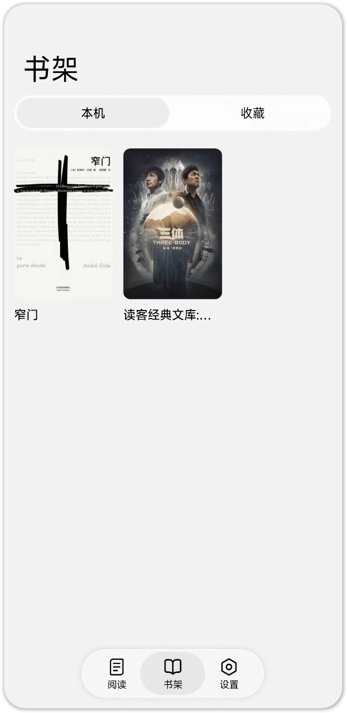
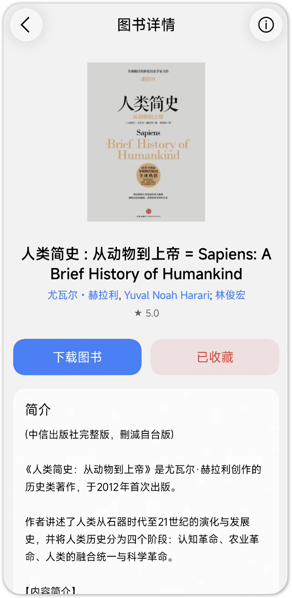
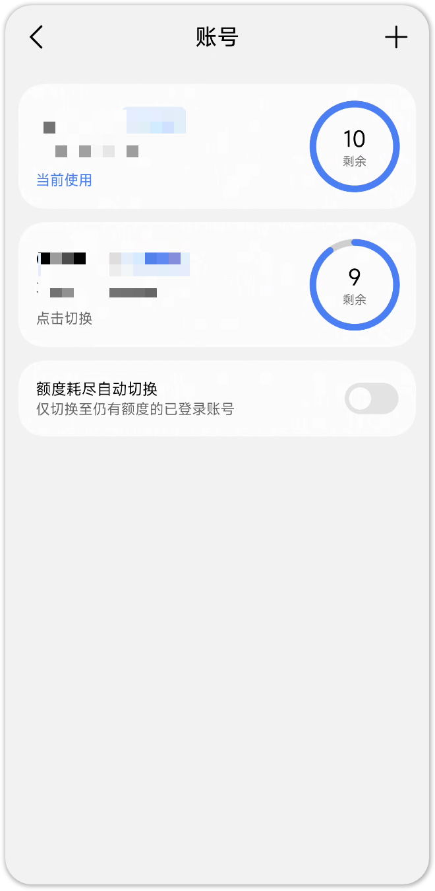
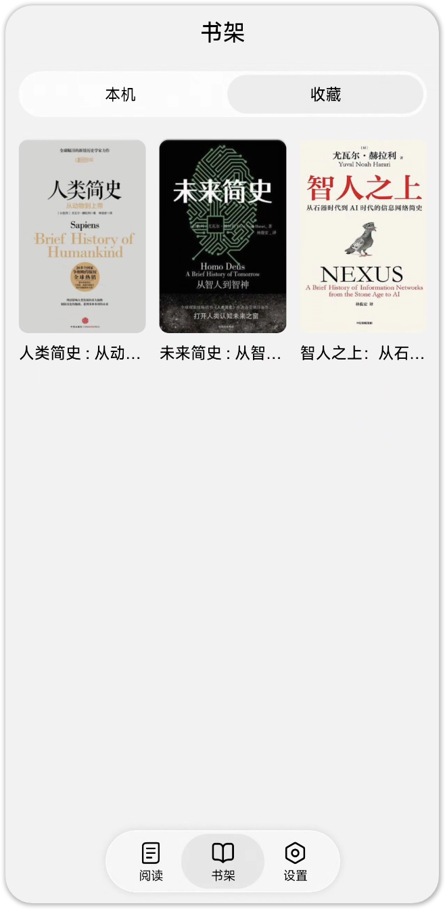
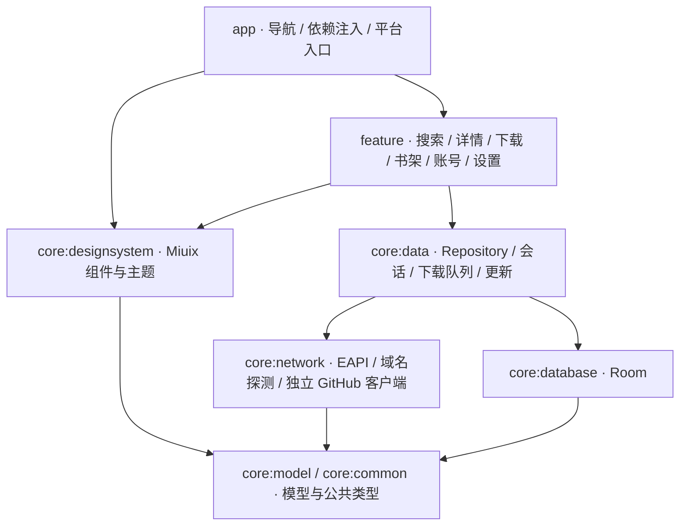

<div align="center">


# 芝士读书

**简洁的 Android Z-Library 非官方客户端**

搜索、收藏、下载与本机文件管理，在一处完成。

<p>
  <a href="https://github.com/qgming/zlib-app/releases/latest"></a>
  
  
  
  
  <a href="LICENSE"></a>
</p>

<p>
  <a href="https://github.com/qgming/zlib-app/releases/latest">下载安装</a> ·
  <a href="#预览">预览</a> ·
  <a href="#核心功能">核心功能</a> ·
  <a href="#快速开始">快速开始</a> ·
  <a href="#构建与打包">构建与打包</a> ·
  <a href="https://github.com/qgming/zlib-app/releases">更新日志</a>
</p>

</div>

---

芝士读书使用 **Kotlin + Jetpack Compose + Miuix** 构建，提供发现、书架与设置三个入口。
图书、收藏和云端下载记录来自你的 Z-Library 账号；下载文件保存在你选择的文件夹，交给你喜欢的阅读器打开。

> 搜索服务说明：目前 Z-Library 移动端搜索服务异常，搜索请求可能返回 Access denied（1.3.0 中文提示为“Z-library 拒绝搜索”）。该功能需等待 Z-Library 官方修复；服务恢复后，通常无需更新本软件即可重新搜索。浏览器网页端可以搜索，不代表移动端搜索服务正常。1.3.0 未修复上游搜索服务。

这是独立的非官方项目，与 Z-Library 无关联或授权关系，不提供图书内容或账号。
请遵守所在地法律、作品版权及服务规则，仅访问和下载你有权使用的内容。

## 预览

<p align="center"></p>
<p align="center"></p>

## 下载安装

前往 **[GitHub Releases](https://github.com/qgming/zlib-app/releases/latest)** 下载正式版 APK。最低支持 **Android 13**，无需 Google Play 服务。

从 **1.3.0** 起，只提供一个正式通用安装包 **`zhishi-<version>-universal.apk`**，包含 `arm64-v8a`、`armeabi-v7a`、`x86_64` 和 `x86` 四种架构，无需按设备挑选。通用版可直接覆盖已有架构版并保留数据，最低 Android 版本要求不变。

1.2.0 及更早版本的独立架构包保留在历史 Release 中。每次发布都附有 `SHA256SUMS.txt`，可核对文件完整性。

当前正式版为 **[v1.3.0](https://github.com/qgming/zlib-app/releases/tag/v1.3.0)**，可直接下载 **[通用 APK](https://github.com/qgming/zlib-app/releases/download/v1.3.0/zhishi-1.3.0-universal.apk)**。

应用会在启动后检查新版，也可在「设置 → 关于 → 检查更新」手动触发。
发现新版后显示真实发布日志；点击更新会在应用内下载并显示进度。现有 1.2.0 已支持选择唯一通用包，发布后可通过检查更新直接升级到 1.3.0，无需过渡版本。
校验通过的 APK 会保存到已授权的下载目录，点击安装后由系统确认；不会静默安装。

## 核心功能

| 分区 | 能力 |
| --- | --- |
| 发现 | 顶部标签切换热门 / 推荐，各自保留滚动位置；关键词搜索、语言 / 格式多选、年份 / 精确匹配 / 排序筛选、自动分页与本机最近搜索；搜索服务状态见上方说明 |
| 图书详情 | 封面、简介、出版信息、纵向相似图书，点击作者或译者搜索，下载前选择服务端提供的文件格式 |
| 多账号 | 邮箱密码登录、Cookie 导入、加密保存会话、手动切换、刷新或退出指定账号、剩余额度展示 |
| 云端收藏 | 查看、分页与刷新收藏，详情中加入或取消收藏；切换账号后隔离数据 |
| 下载管理 | 持久化队列、单任务顺序下载、暂停 / 恢复 / 重试、前台通知、Range 续传与配额保护 |
| 本机书架 | 扫描下载目录及子目录的电子书，外部阅读器打开、系统分享、确认后删除真实文件 |
| 云端下载记录 | 独立查看账号的跨设备下载记录，可确认后删除记录，不影响本机文件或收藏 |
| 域名管理 | 域名体检、手动切换、自定义域名、单独或全部体检、可关闭的自动切换 |
| 外观与语言 | Miuix 玻璃界面，主题模式支持跟随系统 / 浅色 / 深色，软件语言支持跟随系统 / 简体中文 / 英语，自动或 2–5 列封面网格 |
| 应用更新与关于 | GitHub Releases 真实日志按版本展开，默认仅展开最新版本；启动及手动检查、通用包下载、进度、签名校验与系统安装；离线依赖许可默认收起，点击展开全文 |

应用**不内置阅读器**，也不建立独立本地书库或书单。云端下载记录表示账号曾下载过，
不代表文件仍在当前设备；清除下载任务记录不会删除已完成的电子书。

## 快速开始

1. 安装正式通用 APK（1.2.0 及更早版本可选择对应架构包），首次启动先选择并授权下载目录，再使用自己的 Z-Library 账号登录；也可切换为 Cookie 导入。
2. 域名不可用时，点击登录页当前域名右侧的更换按钮，或进入「设置 → 域名管理」。
3. 需要更换或重新授权目录时，进入「设置 → 下载目录」；切换时先暂停当前下载，旧目录文件保留。
4. 在发现页浏览或搜索图书，进入详情选择格式后下载；下载管理从发现页右上角进入。
5. 在「书架 → 本机」打开或分享已下载文件，在「收藏」查看当前账号的云端收藏。
6. 在设置中依次调整「主题模式」「软件语言」「网络格数」。软件语言可选择跟随系统、简体中文或英语；图书、作者、服务端返回的语言名称及原始发布日志保留原文。

只会保存加密后的登录会话，**不保存密码**。账号管理支持添加多个账号；额度耗尽自动切换默认关闭，
开启后也只选择服务端确认仍有额度的有效会话，平台的验证或限制仍然适用。

## 隐私与数据

- **无广告、无遥测、无统计 SDK**，不上传本机文件列表。
- 会话凭据通过 Android Keystore 加密，只向已允许的图书服务域名发送；跨域下载剥离账号凭据。
- 电子书只写入用户通过系统文件选择器授权的目录；本机删除需要确认。
- 更新查询和 APK 下载使用独立的匿名网络客户端，不携带图书账号、Cookie 或密码。
- 不内置 WebView 登录，不抓取网页或绕过网站验证；服务端接口、域名和可用性可能变化。

## 架构



界面使用 MVVM 与 StateFlow；feature 之间不相互依赖，Miuix 由设计系统统一封装。
图书接口行为参考 [heartleo/zlib](https://github.com/heartleo/zlib)，不是将 CLI 打包进 APK。

## 构建与打包

**环境要求**：JDK 21、Android SDK Platform **37.2**、Build-Tools **37.0.0**。
Gradle 由仓库 Wrapper 提供，固定工具链见 [AGENTS.md](AGENTS.md)。

```powershell
git clone https://github.com/qgming/zlib-app.git
cd zlib-app

# 在 local.properties 中配置本机 SDK 路径，例如 sdk.dir=D:/Android/Sdk
# 按下方说明配置本机 key.properties 后，运行检查并生成正式通用包
.\gradlew.bat test lint :app:prepareReleaseAssets
```

macOS / Linux 将 `gradlew.bat` 替换为 `./gradlew`。

### 正式版签名

在项目根目录创建仅保存在本机的 `key.properties`，使用自己的签名信息：

```properties
storeFile=/absolute/path/to/release.jks
storePassword=<store-password>
keyAlias=<key-alias>
keyPassword=<key-password>
```

不要提交该文件、密钥或密码。自行构建所用签名若与官方安装包不同，无法直接覆盖安装。
维护者发布须始终沿用原签名。

### 生成通用发布资产

```powershell
.\gradlew.bat :app:prepareReleaseAssets
```

输出到 `app/build/release/`：

```text
zhishi-<version>-universal.apk
SHA256SUMS.txt
```

日常打包统一使用以上正式通用版任务，只生成一个签名 APK，不附带调试包或独立架构包。

发布时同步递增 `appVersionName` / `appVersionCode`，使用对应的 `vMAJOR.MINOR.PATCH` 标签创建正式 Release，
填写真实更新日志并上传上述资产。当前 1.3.0 使用 versionCode=5，高于 1.2.0 的 4，包名和原签名保持一致；版本变化见 [1.3.0 更新日志](docs/releases/v1.3.0.txt)。具体校验与发布流程见 [发布说明](docs/RELEASING.md)。
正式构建启用 R8 优化和资源裁剪，通用包包含全部四种架构。

## 文档

| 文档 | 内容 |
| --- | --- |
| [架构说明](docs/ARCHITECTURE.md) | 模块、状态与数据流 |
| [EAPI 契约](docs/EAPI.md) | 已核对的图书端点、字段及安全边界 |
| [决策记录](docs/DECISIONS.md) | 功能范围与实现取舍 |
| [测试说明](docs/TESTING.md) | 自动化检查与真机验收 |
| [发布说明](docs/RELEASING.md) | 签名、通用包、校验与发布 |
| [动画说明](docs/ANIMATIONS.md) | 页面切换及 SharedView Kit 适配 |
| [贡献指南](CONTRIBUTING.md) | 环境、规范与提交流程 |
| [术语表](GLOSSARY.md) | 本机文件、下载任务与云端记录的区别 |

## 致谢与开源协议

感谢 [Linux.do](https://linux.do/) 社区对项目的推广与反馈。

感谢 [heartleo/zlib](https://github.com/heartleo/zlib)、[Miuix](https://github.com/compose-miuix-ui/miuix)
及 AndroidX、Kotlin、OkHttp、Coil、Hilt、Room、DataStore 等项目。

项目代码使用 **[MIT License](LICENSE)**。
第三方组件遵循各自许可证，归属信息见 [NOTICE](NOTICE)。

